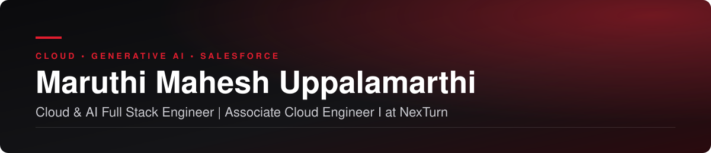

  
  
  

## About

I am an Associate Cloud Engineer at NexTurn, building cloud-native applications with Java, Spring Boot and Azure, and delivering Salesforce, MuleSoft and Generative AI solutions for enterprise teams.

I hold a B.Tech in Electrical and Electronics Engineering from NIT Andhra Pradesh and am pursuing an MBA at IIM Visakhapatnam. I hold 18+ certifications across Microsoft, Oracle, Salesforce and Accenture, and I am open to roles in cloud, AI, Salesforce and full-stack engineering.

**Focus areas:** Cloud & Generative AI · Salesforce & MuleSoft Integration · Microservices & Backend

## Experience

**Associate Cloud Engineer I, NexTurn** · January 2026 – Present
- Architected MuleSoft connectors for Salesforce CRM integration with enterprise backend systems
- Designed and deployed Service Catalogs in Salesforce to automate business request workflows
- Built Slack Agents connected to Salesforce for real-time CRM access within team workspaces
- Led cloud-native deployments on Azure using Spring Boot microservices and REST APIs
- Contributed to Gen AI features using OCI Generative AI and Azure AI services

**Cloud Full Stack Junior Engineer Intern, NexTurn** · September 2024 – January 2026
- Built RESTful APIs and Spring Boot microservices for cloud-native enterprise applications
- Integrated Salesforce CRM data via MuleSoft for automated business workflows
- Contributed to OCI DevOps pipelines and Generative AI proofs of concept

## Education

| Program | Institution | Years |
| --- | --- | --- |
| MBA, Strategy & Product Management | Indian Institute of Management Visakhapatnam | 2025 – 2027 (in progress) |
| B.Tech, Electrical and Electronics Engineering | National Institute of Technology Andhra Pradesh | 2021 – 2025 |

## Tech Stack

              

<b>Cloud & AI:</b> Azure · Oracle Cloud (OCI) · Generative AI · Google Vertex AI · AWS 
<b>Backend:</b> Java · Spring Boot · Microservices · REST APIs · Python · JavaScript 
<b>Salesforce & Integration:</b> Salesforce CRM · Agentforce · Apex · LWC · MuleSoft · Kafka 
<b>Data & DevOps:</b> MySQL · Microsoft Fabric · Power BI · CI/CD · GitHub · Linux

## Featured Projects

| Project | Summary |
| --- | --- |
| **MuleSoft Salesforce Connectors** | Custom MuleSoft connectors that integrate Salesforce CRM with enterprise backends, giving real-time bidirectional data sync, automated lead flows and unified API management across platforms. |
| **Salesforce Service Catalogs** | Service Catalogs in Salesforce that standardize IT and business requests, cutting resolution times with structured intake, approval workflows and automated provisioning pipelines. |
| **Slack Agents for Salesforce** | AI-powered Slack Agents connected to Salesforce, so teams can query CRM data, create records, trigger workflows and manage service requests directly from Slack. |
| **Agentforce AI Agents** | Autonomous AI agents built on Agentforce that handle customer queries, route cases and drive proactive engagement within the Salesforce ecosystem. |
| **Azure Spring Boot Microservices** | Cloud-native deployments on Azure using Spring Boot microservices and REST APIs, with Oracle Cloud DevOps pipelines for delivery of enterprise-grade applications. |
| **Generative AI on OCI and Azure** | Generative AI features and proofs of concept built with OCI Generative AI and Azure AI services, covering LLMs, prompt engineering and vector search. |

## Certifications

**Salesforce:** Certified Agentforce Specialist · Certified Platform Administrator 
**Microsoft:** Azure Developer Associate · Azure Fundamentals · Azure AI Fundamentals · Fabric Data Engineer Associate · SQL AI Developer Associate 
**Oracle:** OCI Generative AI Professional · OCI DevOps Professional · OCI AI Foundations Associate · OCI Data Science Professional · AI Vector Search Professional 
**Agile & Business:** Scrum Fundamentals Certified (SFC) · Business Analysis Fundamentals with AI · Kanban Essentials with AI · Introduction to Digital Marketing 
**Accenture:** Digital Skills: Artificial Intelligence · Digital Skills: Web Analytics
